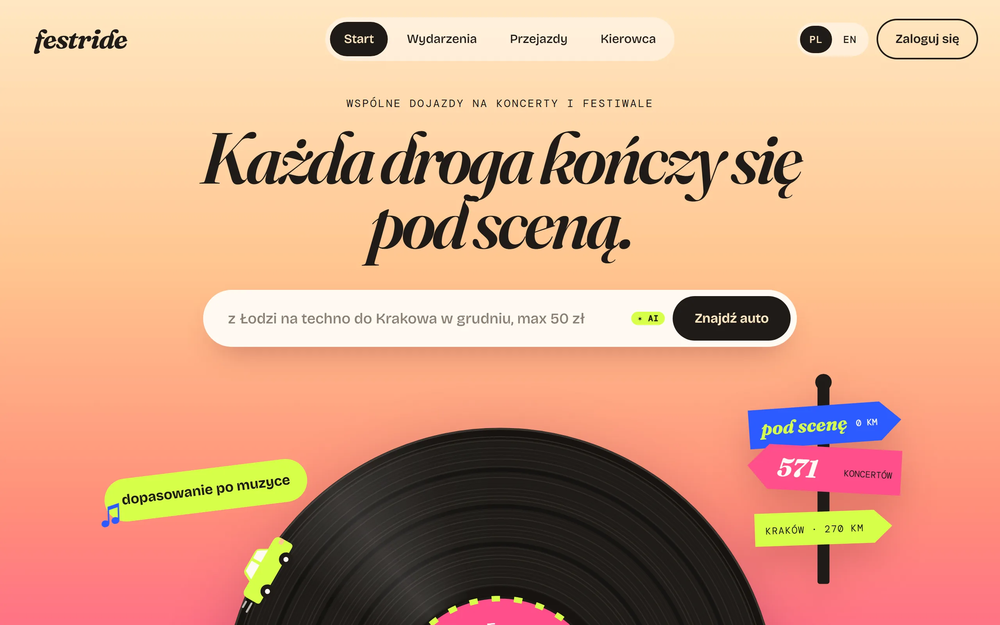
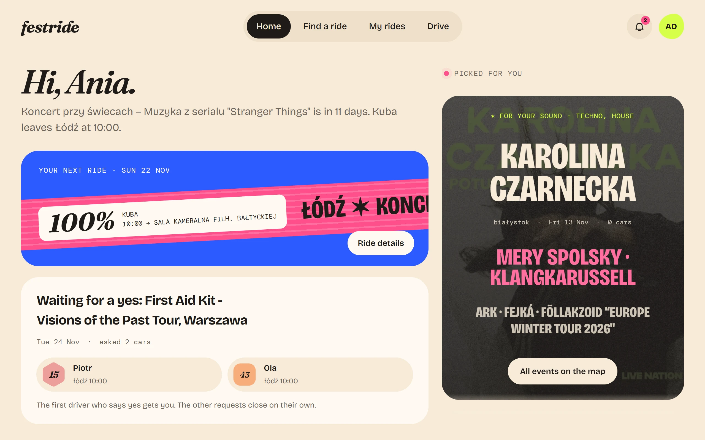
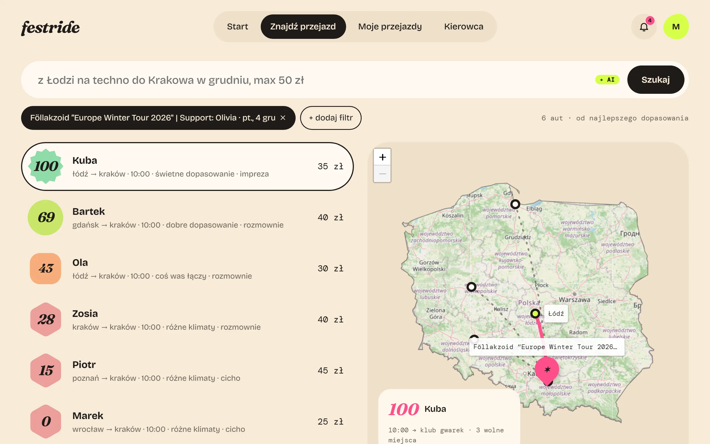
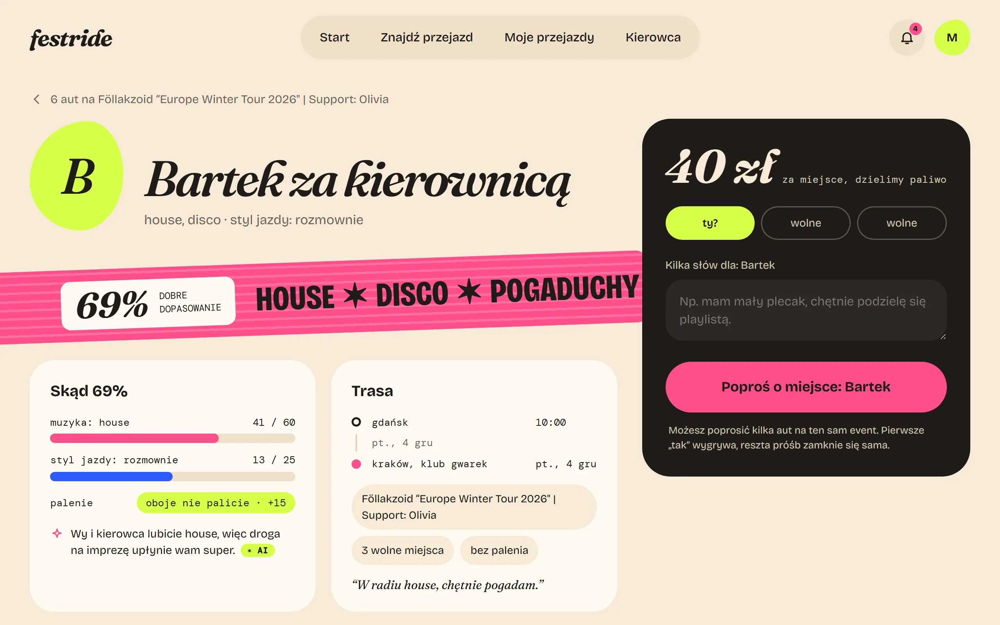
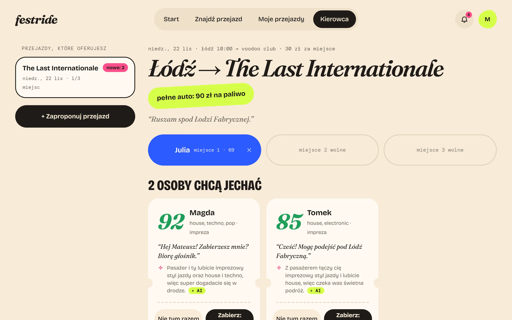
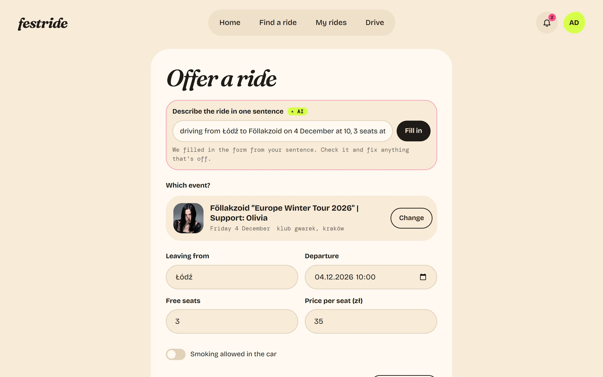
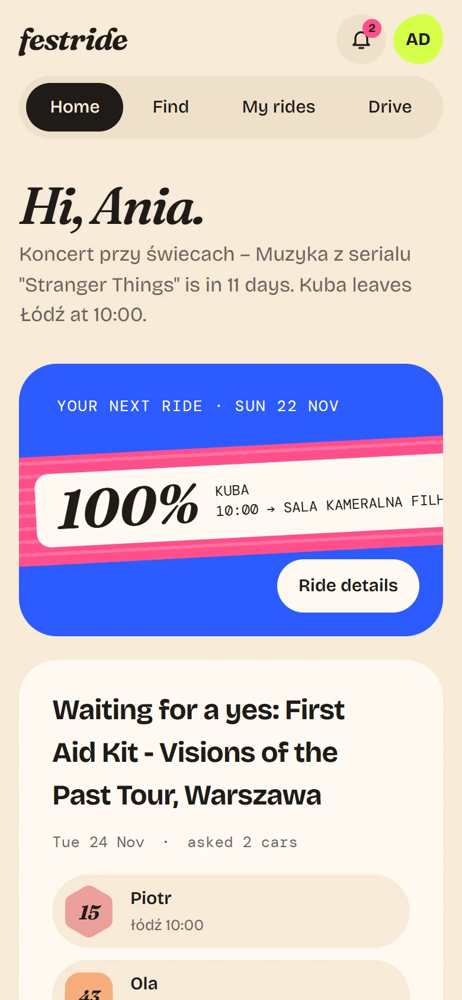
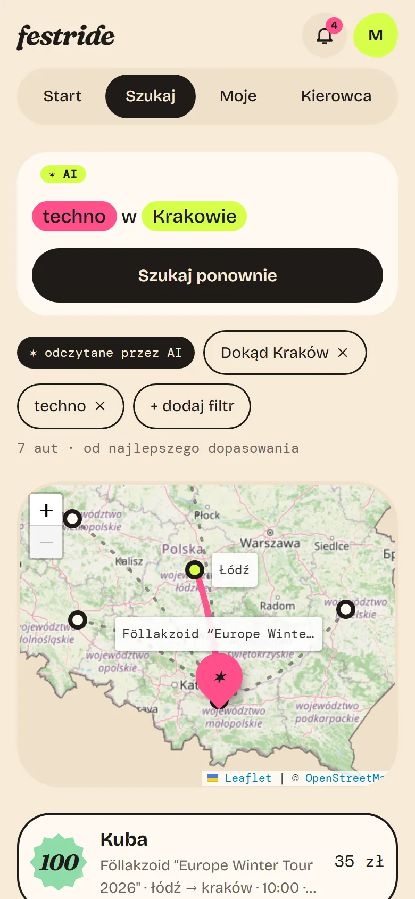

<p align="center">
  
</p>

<h3 align="center">Wspólne dojazdy na koncerty i festiwale w Polsce</h3>

<p align="center">
  <br>
  Wybierz koncert i znajdź <b>ekipę</b>, z którą dobrze się jedzie.
  <br><br>
</p>

<p align="center">
  <a href="https://festride-production.up.railway.app/"></a>
  <br>
  <sub>Konto demo: <code>demo@example.com</code> / <code>festride-demo</code></sub>
</p>


> **✨ Kreatywny twist: vibe check przed jazdą**
>
> Inne aplikacje do wspólnych przejazdów pokazują trasę, cenę i godzinę. FestRide mówi też, **czy dogadacie się w aucie**. Każdy kierowca i pasażer dostaje **wynik dopasowania**, który bierze pod uwagę gust muzyczny, styl jazdy (w ciszy, z rozmową albo z imprezą) i to, czy ktoś pali. Do tego AI w jednym zdaniu podpowiada, dlaczego złapiecie kontakt. Kilka godzin drogi na festiwal to dużo lepsza zabawa z kimś, kto słucha tej samej muzyki.

### 📸 Zrzuty ekranu




<details>
<summary><b>📸 <ins>Więcej ekranów</ins></b></summary>

| |                                                                                                                                                                                                |
|---|------------------------------------------------------------------------------------------------------------------------------------------------------------------------------------------------|
|  |                                                          |
| **Start**: najbliższy przejazd, prośby czekające na odpowiedź, propozycje | **Znajdź przejazd**: kierowcy według dopasowania, trasy na mapie                                                                                                                              |
|  |                                                                                   |
| **Przejazd**: skąd się wziął wynik, plus jedno zdanie podsumowania od AI | **Kierowca**: kto już jedzie i kto czeka na „tak”, z dopasowaniem                                                                                                                                       |
|  |   |
| **Zaoferuj przejazd**: jedno zdanie wypełnia cały formularz | **Na telefonie**: Start i wyszukiwanie z przypiętą mapą, wszystko jest w pełni responsywne                                                                                                     |

</details>

### 🎪 Funkcje


#### 🎧 Poznaj kierowcę, zanim wsiądziesz
Każdy kierowca i pasażer dostaje **wynik dopasowania**, który bierze pod uwagę gust muzyczny, styl jazdy (w ciszy, z rozmową albo z imprezą) i to, czy ktoś pali.

#### 💬 Po prostu powiedz, dokąd jedziesz
Wpisz *„z Łodzi na techno do Krakowa, max 50 zł”*, a zamieni się to w filtry. Kierowcy też mogą dodać przejazd **jednym zdaniem**.

#### ✨ AI, które pomaga, a nie przejmuje stery
Gemini pisze notkę kierowcy i **jedno zdanie o tym, dlaczego się dogadacie**.

#### 🎟️ Jedno miejsce, jedno „tak”
**Pierwsze „tak” zajmuje miejsce** i zamyka twoje pozostałe prośby na to samo wydarzenie.

#### 📱 Wygodne też na telefonie
Strona **dopasowuje się do każdego ekranu**, od telefonu po laptopa, a mapa trasy zostaje pod ręką. Do tego polski / angielski i ciemny motyw.

<details>
<summary><b>📋 <ins>Pełna lista funkcji</ins></b></summary>

**Konto**
- Rejestracja z profilem: gust muzyczny, styl jazdy i to, czy palisz
- Logowanie i wylogowanie
- Edycja profilu

**Wydarzenia i wyszukiwanie**
- Przeglądanie koncertów i festiwali z filtrem po mieście
- Wyszukiwanie przejazdów jednym zdaniem (AI) lub filtrami
- Wyniki posortowane według dopasowania, trasy na mapie

**Jako kierowca**
- Dodawanie przejazdu (formularzem albo jednym zdaniem)
- Odwoływanie przejazdu
- Akceptowanie i odrzucanie próśb o miejsce
- Usuwanie pasażera z przejazdu

**Jako pasażer**
- Wysyłanie prośby o miejsce z wiadomością do kierowcy
- Wycofywanie prośby albo rezygnacja z potwierdzonego miejsca
- Lista własnych próśb i ich statusów

**Powiadomienia**
- O nowych prośbach, akceptacji, odrzuceniu, wycofaniu i odwołaniu przejazdu

</details>

### 🛠️ Technologie


| Kategoria | Stack |
|---|---|
| **Backend** |     |
| **Logowanie** |  |
| **Frontend** |    |
| **Mapa** |   |
| **AI i dane** |   |
| **Testy** |  |

### 🚀 Szybki start


Około 5 minut, bez kluczy API. Potrzebujesz **Pythona 3.11+**, **Node 20+** i dwóch terminali.

**1. Backend**

```bash
cd backend
python -m venv .venv
# Windows:      .venv\Scripts\activate
# macOS/Linux:  source .venv/bin/activate
pip install -r requirements.txt
cp .env.example .env              # Windows (cmd): copy .env.example .env

python import_events.py           # wydarzenia (z Ticketmastera, jeśli masz klucz, inaczej 4 duże festiwale)
python seed_demo.py               # demo: użytkownicy, przejazdy i prośby
uvicorn app.main:app --reload --port 8000
```

**2. Frontend**

```bash
cd frontend
npm install
npm run dev
```

**3. Otwórz** http://localhost:5173 i zaloguj się:

> **E-mail:** `demo@example.com` &nbsp;·&nbsp; **Hasło:** `festride-demo`

Wydarzenia demo są aktualne przez około tydzień; odświeżysz je poleceniem `python seed_demo.py --reset`.

**Opcjonalne klucze** w `backend/.env`: `TICKETMASTER_API_KEY` ([do pobrania tutaj](https://developer.ticketmaster.com)) dla prawdziwych wydarzeń,
`GEMINI_API_KEY` ([za darmo](https://aistudio.google.com)) dla AI. Po dodaniu klucza Ticketmastera uruchom jeszcze raz `import_events.py` i `seed_demo.py --reset`.

**Testy** (backend, 113 testów):

```bash
cd backend
pytest
```

### ✨ Jak korzystałam z narzędzi AI


FestRide zbudowałam z pomocą **Claude Code** (CLI), ale kluczowe decyzje podejmowałam sama i sama przeglądałam kod.

#### 1. Planowanie z grill-me

Zaczęłam od skilla **grill-me**. Opisałam aplikację i funkcje, które chciałam mieć, a Claude zadawał mi pytania, dopóki plan nie był jasny: technologie, zakres i działanie każdej funkcji. Każda decyzja trafiła do [`docs/decisions.md`](docs/decisions.md). Poprosiłam też Claude'a, żeby po każdym kroku planu otwierał pull request.

#### 2. Subagenci

Przygotowałam trzech subagentów, każdego do innego zadania:

- **code-reviewer** sprawdzał kod po każdym kroku, przed pull requestem
- **match-evaluator** sprawdzał, czy algorytm dopasowania dobrze liczy wyniki i układa ranking
- **ai-prompt-tester** wysyłał do funkcji AI prawdziwe i podchwytliwe zapytania i sprawdzał odpowiedzi

Potem Claude pisał backend krok po kroku, a ja sprawdzałam go na żywo i przeglądałam każdy pull request.

#### 3. Szukanie kierunku wizualnego

Kiedy backend działał, przyszła pora na frontend. Nie jestem graficzką i nie byłam pewna wyglądu, więc poprosiłam o pomoc AI i wypróbowałam trzy połączenia. Każde działało w osobnej sesji CLI i w nowym folderze projektu, więc nie wiedziało o pozostałych skillach ani projektach:

| Połączenie | Efekt |
|---|---|
| Claude Design + frontend-design | Czysto, ale prosto. Z daleka było widać, że zrobiło to AI. |
| Claude + Mobbin + impeccable | Za każdym razem ten sam układ. Nie miało klimatu aplikacji i wyglądało jak inny projekt wrzucony w środek. |
| **Claude + Mobbin + taste-skill** | **Zwycięzca.** Kolorowa strona z prawdziwym festiwalowym klimatem, bez typowego wyglądu „od AI”. Mobbin dał wzorce projektowe, a taste-skill zrobił ekrany. |

Przekazałam swoje uwagi i dodałam szczegóły, które pokazują, że to aplikacja do wspólnych dojazdów dla fanów muzyki, a nie kolejna aplikacja muzyczna. Zanim wybrałam ostatecznie, zapytałam też koleżankę, czy projekt ma własną tożsamość wizualną. Jestem bardzo zadowolona z efektu, a Mobbin okazał się świetną pomocą przy ładnym UI/UX.

#### 4. Budowanie i testowanie

Claude zbudował wybrany projekt 1:1 w kodzie, a ja śledziłam zmiany na bieżąco. Potem testowałam stronę, spisywałam znalezione błędy i robiłam to samo z wersją mobilną, aż była w pełni responsywna. Do testów używałam skilla **claude-in-chrome**, żeby Claude mógł sprawdzać stronę w mojej przeglądarce, a równolegle testowałam ją też ręcznie.

Subagenci naprawdę się opłacili, zwłaszcza **code-reviewer**. Po każdym kroku znajdował sporo błędów, które były poprawiane przed pull requestem. Z match-evaluatora i ai-prompt-testera skorzystałam po razie, żeby na koniec przetestować te funkcje.

#### <ins>Podsumowanie</ins>

AI używałam prawie na każdym etapie projektu, ale kod i tak sprawdzałam sama, a stronę i jej funkcje testowałam ręcznie. Wybrałam znany mi stack, żeby móc świadomie oceniać każdą zmianę w kodzie.

Najbardziej pomogło mi planowanie z grill-me, zanim powstała pierwsza linijka kodu, code review po każdym kroku oraz Mobbin z taste-skill przy projekcie, który nie wygląda na zrobiony przez AI.

Dzięki AI praca poszła dużo szybciej, zbudowanie takiej strony ręcznie zajęłoby mi o wiele więcej czasu.


### 💡 Pomysły na rozwój


#### Przejazdy
- [ ] Przejazd powrotny dodawany od razu przy tworzeniu przejazdu
- [ ] Edycja przejazdu (zmiana godziny czy liczby miejsc)
- [ ] Lista oczekujących, gdy przejazd jest pełny
- [ ] Automatyczne wyliczanie kosztów paliwa na osobę
- [ ] Płatności przez aplikację

#### Ludzie i zaufanie
- [ ] Czat między kierowcą a pasażerem
- [ ] Wzajemne oceny kierowcy i pasażerów po przejeździe
- [ ] Zdjęcie profilowe i weryfikacja kierowcy
- [ ] Media społecznościowe w profilu, żeby lepiej się poznać
- [ ] Zgłaszanie i blokowanie użytkowników

#### Festiwalowy klimat
- [ ] Playlista na Spotify dopasowana do gustu muzycznego pasażerów i artystów z festiwalu, na który się jedzie
- [ ] Integracja z organizatorami festiwali

#### Konto i powiadomienia
- [ ] Reset hasła, weryfikacja i zmiana maila
- [ ] Powiadomienia push i mailowe
- [ ] Aplikacja mobilna do zainstalowania na telefonie


### 🙏 Podziękowania


- **Xelerit**, za możliwość zbudowania tego projektu
- **[Ticketmaster Discovery API](https://developer.ticketmaster.com)**, za dane o wydarzeniach
- Współtwórcom **[OpenStreetMap](https://www.openstreetmap.org/copyright)** i **[Leaflet](https://leafletjs.com)**, za mapę
- **Krzysztofowi Popławskiemu**, za zdjęcia z festiwali na stronie głównej (CC BY 4.0)

